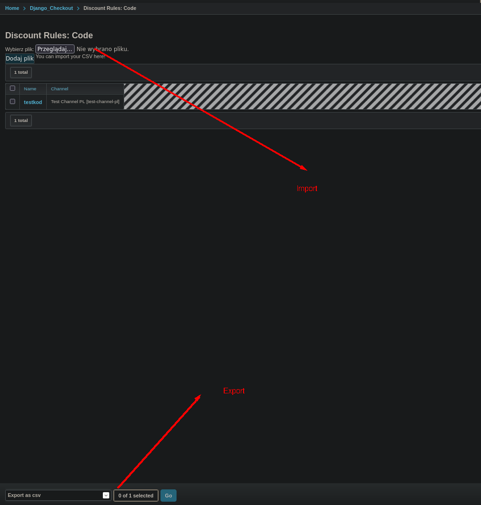

# DISCOUNT
Aby role koszykowe działały poprawnie należy dobrze ustawić pola w DiscountRule:


Aby dodać disocunt do koszyka należy dodać go za pomocą PATCH/POST
Przykład PATCH:

```json
{
    "cart": {
        "items": [
            {"sku": "MAX-36-Czarny", "quantity": 6},
            {"sku": "MAX-38-Czarny", "quantity": 6}
        ],
        "discounts": [
            {"code": "test"}
        ]
    }
}
```

Aby dodać gratis do koszyka należy dodać go za pomocą PATCH/POST. Więcej o gratisach w [gratis.md](gratis.md).
Przykład PATCH:

```json
{
    "cart": {
        "items": [
            {"sku": "MAX-36-Czarny", "quantity": 6},
            {"sku": "MAX-38-Czarny", "quantity": 6}
        ],
        "discounts": [
            {
              "code": "test_step",
              "sku": "demo-120150-403",
              "quantity": 1
            }
        ]
    }
}
```

## One code per channel and currency

A code (`DiscountCode.code`, matched exactly, case included) is unique per channel and currency. Two rules clash on
a code when both hold it, share a channel and share a currency; a rule without currencies holds every currency.
Every rule counts, active or not, typed or automatic, so switching a rule on never makes a clash. The same code
on rules of other channels, or of currencies that do not overlap, is fine: `GRATIS_STEP` on an EUR rule and on a
PLN rule of one channel is the pattern for a code per currency.

| Rule A | Rule B, same channel | Same code allowed |
|---|---|---|
| EUR | PLN | yes |
| EUR | EUR, PLN | no (EUR) |
| EUR | no currencies | no (EUR) |
| no currencies | no currencies | no (every currency) |
| EUR, channel `a` | EUR, channel `b` | yes |

Why: the cart applies a code from one rule and the v1 order counts its use on one code row; with two rows in
the same channel and currency they can pick different rows, so `max_used` and `max_uses_per_user` drift.

Every write path refuses a new clash; a clash stored before keeps working, and an edit that does not touch it
(the CMS sends the whole rule and the whole code on every save) goes through:

| Path | Refused when | Answer |
|---|---|---|
| v2 admin `POST discount-rules/{id}/codes/`, `PATCH .../codes/{code_id}/` | the new or renamed code clashes, another row of the same rule included | 400 `VALIDATION_ERROR`, `details[0]`: `field` `code`, `issue` `UNIQUE` |
| v2 admin `POST discount-rules/` with `codes` | one of them clashes, or one code comes twice | 400 on `codes.<i>.code`; nothing is created |
| v2 admin `PATCH discount-rules/{id}/` | new `channels` or `currencies` make a code of the rule clash with a row it did not clash with before | 400 on `currencies` (or `channels` when only they changed); nothing changes |
| Django admin, code page and the rule's codes inline | the same, checked against the channels and currencies the rule form is about to save | form error |
| `import-discount-rules` (and the CSV import in the Django admin) | a code clashes: the code is skipped with a warning in the log; new channels clash: the row is skipped | |

The `description` names the code, the other rule, the channel and the shared currencies:
`Code 'SUMMER' is already used by discount rule 140 in channel default-europe for EUR; a code is unique per
channel and currency.` Fixtures (`loaddata`) and direct ORM writes bypass the check.

List the clashes stored before (read-only); the CMS shows the same rows through django-munin:

```bash
python manage.py check --database default --tag checkout.discount_codes
```

One warning per channel, e.g. `CHEAPEST_FREE: rules 102, 130 (EUR); TWICE: rule 7 twice (every currency)`. Clean
up by giving each rule its own code or by narrowing a rule's currencies; the database has no constraint for it
(channels and currencies are many-to-many), so the check is the only report.
